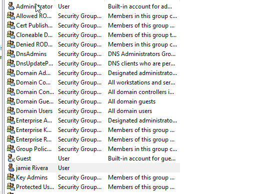

# 🧾 Incident 001: Active Directory User Account Creation

## 📌 Overview

This lab exercise demonstrates a basic Tier 1 help desk user-provisioning workflow using Active Directory Users and Computers (ADUC).

A new user object, Jamie Rivera (`jrivera`), was created in the `corp.local` domain. The available screenshot confirms that the user object appears in Active Directory.

## 🖥️ Lab Environment

- **Domain:** `corp.local`
- **Domain Controller:** `DC01-NEW`
- **Operating System:** Windows Server 2022
- **Directory Service:** Active Directory Domain Services (AD DS)
- **Management Tool:** Active Directory Users and Computers (ADUC)
- **Virtualization Platform:** Oracle VirtualBox

## ⚙️ Tasks Demonstrated

- Creating a domain user object
- Specifying a display name and username
- Locating the created user in Active Directory
- Capturing screenshot evidence for documentation

## 🧪 Evidence and Validation

The available screenshot confirms that Jamie Rivera appears in the Active Directory Users list.

The screenshot does not independently verify the account's enabled status, password settings, group memberships, or successful sign-in. These should only be described as verified if supported by additional evidence.

## 📸 Screenshot Evidence

*Evidence: Jamie Rivera appears in the Active Directory Users list.*

Confirm that this image path matches the actual file in the repository.

## 📄 Related Documentation

- [Incident Report](incident-report.md)

## 🎯 Skills Demonstrated

- Active Directory user provisioning
- Windows Server administration fundamentals
- ADUC navigation
- Technical documentation and evidence handling
- Security-conscious documentation practices

## 🧭 Tier 1 Help Desk Context

Creating user accounts is a common service desk task. Proper documentation records the requested identity, the action performed, and the evidence available to verify completion.

**Documented outcome:** User object creation evidenced. Additional account configuration and sign-in validation are not established by the available screenshot.