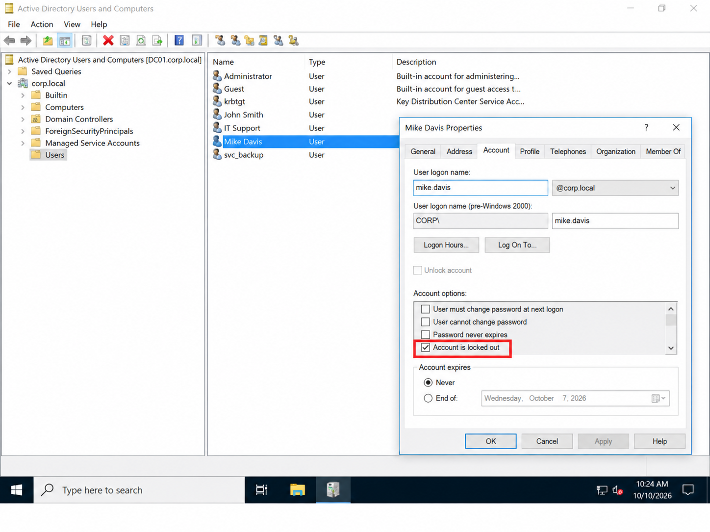
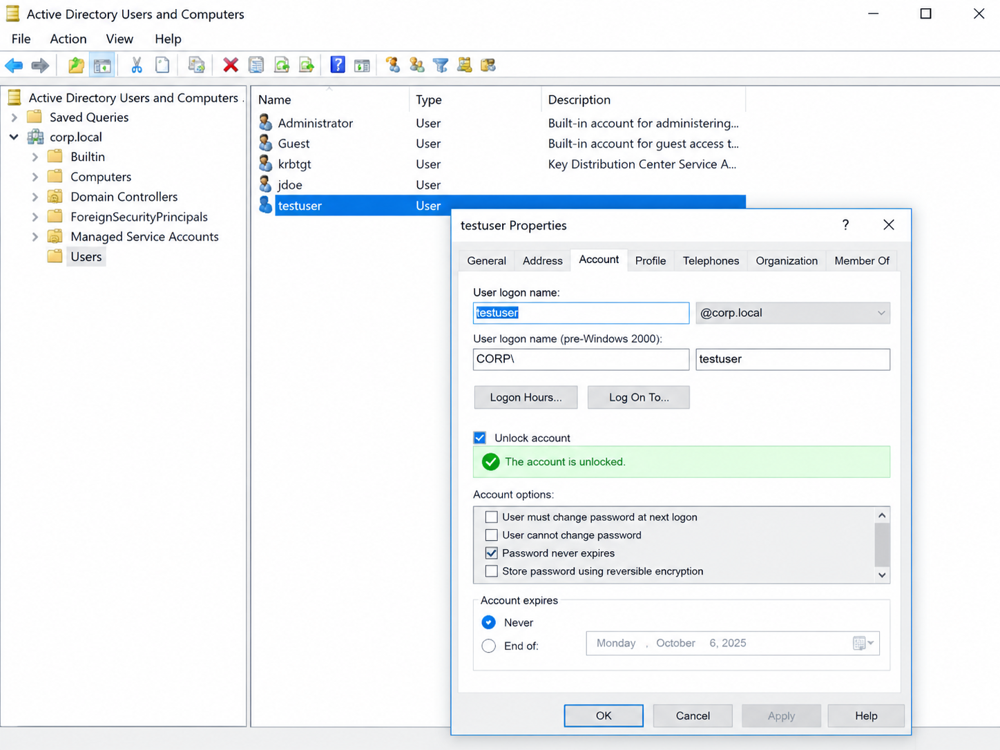

# 🧾 Incident Report: Active Directory Account Lockout

## 🎫 Ticket Information

- **Ticket ID:** `INC-003-account-locked`
- **Issue Type:** Account Access / Active Directory
- **Priority:** Low
- **Affected User:** `jdoe`
- **Domain:** `corp.local`
- **Domain Controller:** `DC01-NEW`
- **Status:** Account unlock documented; final authentication verification pending

## 🧩 Summary

This lab exercise simulates a Tier 1 help desk incident involving an Active Directory user account lockout.

The objective is to identify the affected account, inspect its lockout state, unlock the account using Active Directory Users and Computers (ADUC), and verify the resulting account state.

A successful sign-in must be tested separately before full restoration of access can be confirmed.

## 📌 Issue Description

The `jdoe` account was used for an account-lockout troubleshooting exercise in the `corp.local` Active Directory domain.

An account lockout can prevent authentication after a configured number of unsuccessful sign-in attempts. The lockout policy and the account's actual state should be checked rather than assumed.

## 🖥️ Environment

- **Operating System:** Windows Server 2022
- **Domain:** `corp.local`
- **Domain Controller:** `DC01-NEW`
- **Directory Service:** Active Directory Domain Services (AD DS)
- **Management Tool:** Active Directory Users and Computers (ADUC)
- **Virtualization Platform:** Oracle VirtualBox

## 🔍 Troubleshooting and Resolution

1. Opened Active Directory Users and Computers on the domain controller.
2. Located the affected user account, `jdoe`.
3. Inspected the account to identify its lockout state.
4. Used the available ADUC account-management options to unlock the account.
5. Rechecked the account state after the unlock operation.
6. Identified successful user sign-in as a separate validation step.

Only steps supported by the actual lab work and screenshots should be recorded as completed.

## 🧪 Validation

**Evidence to confirm:**

- The account was locked before the unlock operation.
- The account was unlocked afterward.

**Additional validation required:**

- Successful interactive sign-in using the account.
- Successful access to the intended domain resources.
- Confirmation of the applicable account-lockout policy settings.

An unlocked account does not, by itself, prove that authentication is successful.

## 📸 Screenshot Evidence

### 1. Account Locked Before Resolution

**File:** `screenshots/003-account-locked-before/003-account-locked-before.png`

This screenshot should show the account's locked state before the unlock operation.

### 2. Account Unlocked After Resolution

**File:** `screenshots/003-account-unlocked-after/003-account-unlocked-after.png`

This screenshot should show the account's state after the unlock operation.

Confirm that both image paths match files that actually exist in the repository.

## ⚙️ Account Lockout Policy

The intended lab policy settings are:

- **Account lockout threshold:** 5 invalid logon attempts
- **Account lockout duration:** 15 minutes
- **Reset account lockout counter after:** 15 minutes

These are intended values, not confirmed configuration. Verify the actual domain policy before reporting them as active settings.

## 🛡️ Prevention and Best Practices

- Verify the user's identity according to the organization's support procedures.
- Check the account's lockout state before making changes.
- Unlock the correct account and document the action.
- Investigate repeated lockouts if they continue after the account is unlocked.
- Validate authentication separately from the administrative unlock operation.

## 🧠 Skills Demonstrated

- Active Directory Users and Computers (ADUC)
- User account troubleshooting
- Account lockout identification and resolution
- Windows Server administration fundamentals
- Screenshot evidence capture
- Incident documentation and post-resolution validation

## ✅ Outcome

This incident documents the account-lockout troubleshooting workflow. The account should only be marked fully resolved after the unlock state has been verified and successful authentication has been tested.

**Final Status:** Account unlock documented; successful sign-in and policy configuration require verification.